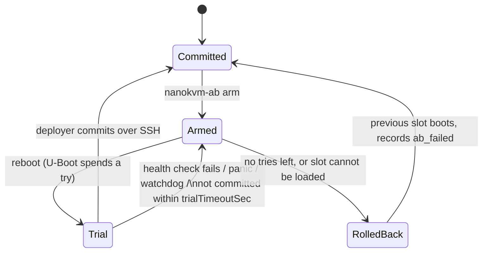

# nanokvm

A minimal, fully static OS for the Sipeed NanoKVM Lite/Full (SG2002), with
A/B full-image deploys from a host machine, automatic rollback and a hardware
watchdog armed by the bootloader.

- System: [mixos](https://github.com/jmbaur/mixos) (busybox init, runit,
  mdev). Every userspace executable comes from `pkgsStatic` (musl, static).
  The whole system is an erofs image inside the initrd and runs from RAM.
- Board support (mainline Linux, U-Boot, OpenSBI, FIP, device trees):
  [nixos-nanokvm](https://github.com/georgewhewell/nixos-nanokvm) packages.
  `overlays/latest.nix` pins the kernel (7.3), U-Boot (2026.10) and OpenSBI
  (1.9) to their latest releases, and builds the FSBL (BL2 and DDR
  initialisation) from Sipeed's source (`pkgs/sg2002-fsbl`) instead of
  taking it from a release image.
- Kernel: nixos-nanokvm's SG2002 patch set with a minimal configuration,
  `allnoconfig` plus `lib/kernel-config.nix`, all built in (no modules).
  It drives the NanoKVM's hardware: HDMI capture (LT6911 bridge, CSI,
  VPSS scaler, Coda980 H.264 encoder), the USB device port (HID, mass storage, ECM/NCM/RNDIS,
  ACM gadgets via configfs), ATX buttons and LEDs (GPIO character
  devices, `/dev/mem` for pad muxing), the OLED, Ethernet, SD card,
  eFuse, RTC, thermal sensor, cpufreq and the watchdog. The `kernel-config`
  check fails if an enabled device-tree node lacks a built-in driver and
  is not listed as unused. Unused: audio (the microphone and codecs belong
  to the LicheeRV module; Sipeed's NanoKVM firmware ships no audio driver
  either), the ADC and PWM.
- H.264: the Coda980 encoder needs Sipeed's proprietary firmware and is
  off by default. `nanokvm.h264Encoder.enable = true` builds the driver
  and the firmware into the kernel.
- Card layout: declared once (`lib/layout.nix`), used for the SD image and
  by [disko](https://github.com/nix-community/disko), whose generated
  create script formats `/data`.

## Card layout

| Part | Start | Size | Contents |
| --- | --- | --- | --- |
| p1 | sector 1 | 16 MiB | FAT16 `fip.bin` (FSBL, OpenSBI, U-Boot). Never touched by deploys. |
| (gap) | 20 MiB | 2 × 64 KiB | A/B state: two copies of a U-Boot environment block (CRC32 + `name=value`) |
| p2 | 24 MiB | `slotSizeMiB` (256 MiB) | slot A: FAT with `Image`, `initrd`, `sg2002.dtb`, `extlinux/extlinux.conf` |
| p3 | after p2 | `slotSizeMiB` | slot B |
| p4 | after p3 | rest of card | btrfs, mounted by mixos as `/state` (`/var`, `/root`, `/home`, `/etc` overlay, SSH host key) |

MBR, not GPT: the SG2002 BootROM finds `fip.bin` only through MBR entries.
Linux never mounts the slots; U-Boot picks one.

## Building

Cross-compiled to riscv64 on x86_64-linux or aarch64-linux. From macOS,
use a Linux VM or a Linux remote builder.

```sh
nix build .#sd-image   # first flash
nix build .#slot       # what deploys write
```

Optionally put your SSH key in `configuration.nix` (deploys need a key).

## Logging in

Root logs in over SSH (dropbear) with:

- the password `root` (`nanokvm.rootPassword`; `passwd` changes it, and the
  change persists in `/state`; `null` turns password logins off);
- keys built into the image (`nanokvm.authorizedKeys`);
- keys in `/root/.ssh/authorized_keys` on the device (`/state`);
- keys in an `authorized_keys` file on the card's FAT partition
  (`FIRMWARE`), which any computer can write.

Keys are read when dropbear starts: `sv restart dropbear` after editing.
Without DHCP, connect over the link-local address the OLED shows:
`ssh root@fe80::…%<your interface>`.

## First flash (also the full wipe)

With the card in this machine's reader (Linux or macOS):

```sh
nix run .#flash-sd -- /dev/sdX                    # this flake's image (Linux)
nix run .#flash-sd -- --image nanokvm-sd.img.zst /dev/disk6   # a release download
```

On macOS the tool carries no image of its own (that would need a Linux
builder): pass `--image`.

It refuses fixed disks, asks before erasing, writes through `sudo` when
needed and reads the card back against the image's SHA-256. Options:
`--backup FILE` saves the old card first (zstd), `--authorized-keys FILE`
puts root's keys on the FAT partition, `--yes` skips the question.

Release images (GitHub releases) are built from this repository's
`configuration.nix`: no keys, password `root`. By hand:
`zstdcat nanokvm-sd.img.zst | sudo dd of=/dev/sdX bs=4M conv=fsync`.

Slot A holds the image, slot B is empty, and the A/B state area is blank
(meaning "boot slot A"). On first boot `/state` is created and grown to the
end of the card.

## First flash without opening the case

The NanoKVM Full's card sits under the heatsink. While it runs Sipeed's
stock firmware, flash it over the network instead (enable SSH in the stock
web UI first; root's password is the web password):

```sh
nix run .#flash-from-stock -- root@<stock-ip>
```

1. Checks the unit runs the stock firmware on the cube's beta carrier
   (`/etc/kvm/hw`) and that the card and free memory are large enough.
2. Stages static `busybox`, `zstd`, the device script and the image in a
   tmpfs on the device, and checks the image's SHA-256 there.
3. Stops the stock services and remounts everything on the card read-only
   (`sysrq u` if a plain remount fails).
4. Saves the stock system (MBR, boot and root partitions, up to the end of
   p2) to `./nanokvm-stock-<host>-<time>.img.zst`, with its size and SHA-256
   in a `.txt` next to it. The stock USB-drive partition (p3) is not saved.
5. Writes the image from RAM, drops the page cache, reads the card back
   against the image's SHA-256 and only then reboots. A failed check leaves
   the read-only stock system running; nothing reboots into a bad card.
6. Waits for the new system's SSH and prints `nanokvm-ab status`.

Options: `--backup FILE`, `--no-backup`, `--yes`, `--no-wait`,
`--timeout SEC`, `-o OPTION`.

## Recovery (USB fastboot)

U-Boot enters USB fastboot on the HID USB-C port (the one below HDMI on
the Full; plug it into a computer) when:

- neither slot can be loaded, or
- `maxUnconfirmedBoots` (default 6) boots in a row ended without Linux
  passing its health check: a slot that panics, hangs (the watchdog resets
  it) or never starts dropbear. With ~86 s per watchdog reset that is
  about nine minutes. U-Boot resets the count when it enters recovery, so
  a power cycle gives the slot six more tries.

Targets: `mmc0` (the whole card), `slota`, `slotb` (raw block ranges of
the slots; nothing outside a slot can be written through them). Images
must be uncompressed; the client sends large ones as sparse chunks.

```sh
nix shell nixpkgs#android-tools
fastboot devices
zstd -d result/slot.img.zst -o slot.img && fastboot flash slota slot.img
zstd -d nanokvm-sd.img.zst -o sd.img && fastboot flash mmc0 sd.img        # whole card, resets /state
zstd -d nanokvm-stock-….img.zst -o stock.img && fastboot flash mmc0 stock.img  # back to Sipeed's firmware
fastboot reboot          # or `fastboot continue` to boot the slots now
```

After restoring the stock backup, reformat its USB drive (p3) from the
stock web UI: the backup does not include it. `fastboot oem run "<cmd>"`
runs any U-Boot command.

## Deploying

```sh
nix run .#deploy -- root@nanokvm.local
```

1. Checks the device runs its committed slot and not already this image.
2. Streams the compressed slot image over SSH into the inactive slot. The
   device checks the transfer's SHA-256, writes the slot and reads it back
   against the image's SHA-256.
3. Arms the slot for `--tries` trial boots (default 3) and reboots.
4. Waits for SSH, checks the trial slot runs the image and commits it.



Exit status: `0` deployed, `1` error, `3` the device came back on the
previous slot.

| Option | Effect |
| --- | --- |
| `--tries N` | trial boots before rollback (1–`maxTries`) |
| `--timeout SEC` | how long to wait after rebooting (default 900) |
| `--wipe-data` | also reformat `/state` on the next boot |
| `--no-reboot` | write and arm only |
| `--force` | redeploy the running image |
| `-o OPTION` | extra `ssh` option |

## On the device

```text
nanokvm-ab status               slot, trial and environment state
nanokvm-ab commit               accept the running trial
nanokvm-ab rollback             reject the running trial and reboot
nanokvm-ab cancel               drop an armed trial
nanokvm-ab request-wipe-data    reformat /state on the next boot
```

## Wiping

- `/state` only: `nanokvm-deploy --wipe-data`, or `nanokvm-ab
  request-wipe-data` and reboot. Before mounting, `state.init` erases p4
  (`wipefs`) and disko's create step formats it again. This also resets the
  SSH host key.
- Everything: reflash the card.

## Watchdog

The boot script arms the SoC's DesignWare watchdog (WDT0, ~86 s) with three
register writes right before it loads a slot; U-Boot's own watchdog driver
hangs U-Boot on this board. Once armed it cannot be stopped, so it is armed
only after the recovery decision: fastboot recovery waits indefinitely. The
kernel's `dw_wdt` finds it running and feeds it until userspace opens it
(`watchdog.open_timeout=120`: no userspace within two minutes means a
reset). mixos init then holds it through boot, and busybox `watchdog` feeds
it afterwards. A hang anywhere after U-Boot loads a slot resets the board;
during a trial that spends a try, and repeated resets end in fastboot
recovery (above).

## Web KVM

`nanokvm-kvm` (`pkgs/nanokvm-kvm`, C) serves a web UI on port 8080 of
localhost; it has no login of its own, so reach it through SSH:

```sh
ssh -L 8080:localhost:8080 root@nanokvm   # then open http://localhost:8080
```

- Video from the HDMI input (LT6911 bridge, 1080p UYVY), in the mode chosen
  in the UI (`nanokvm.kvm.mode` sets the default).
- Keyboard (USB boot keyboard; Caps Lock state from the target) and an
  absolute pointer (USB HID gadget on the HID USB-C port), paste as typed
  text (US layout), Ctrl+Alt+Del, full screen with keyboard lock.
- ATX: power (short press, 5 s force off), reset, power LED.

Measured on the board with a 1080p desktop: frame rates in a browser while
the cursor moves, and when every picture is redrawn whole (a viewer asking
for a key frame every 30 ms):

| Mode | Encoding | Cursor moving | Whole pictures | Bit rate (cursor) |
| --- | --- | --- | --- | --- |
| `tiles` (default) | changed 32×32 tiles, LZ4, native size | 23 fps | 12 fps | 3.9 Mbit/s |
| `mjpeg` | JPEG of the changed rows, full size | 14 fps | 5 fps | 1.7 Mbit/s |
| `mjpeg-half` | the same at half size (960×540, VPSS scaling) | 20 fps | 14 fps | 0.9 Mbit/s |
| `h264` | Coda980, intra-only, WebCodecs in the browser | 30 fps | 30 fps | ~3 Mbit/s |

`nanokvm-kvm --bench` prints the CPU figures for the current picture.

- The MJPEG modes send only the band of rows holding changed tiles, as a
  JPEG drawn at its row. With `nanokvm.kvm.c906l.enable`, the SoC's 700 MHz
  C906L encodes the bottom part of each band while the main core encodes
  the top and goes on to compare the next frame; the C906L's part goes out
  when done. Its share grows while it finishes before the next band is due
  and shrinks when the main core waits for it (about 75% at half size).
  `tiles` stays on the main core: its LZ4 is memory-bound, and the C906L
  took 37 ms for a whole picture against 34 ms here, plus the copy into
  its memory.
- The C906L runs `pkgs/nanokvm-kvm/c906l` (bare-metal C, IJG libjpeg),
  which nanokvm-kvm loads and starts through `/dev/mem` at startup, so it
  ships with each slot. Its 8 MiB at `0x8f800000` (`lib/c906l.nix`) are
  hidden from Linux by U-Boot (`memoryTopHide`) and a reserved-memory node
  in the device tree; frames are copied in (Linux cannot learn the physical
  address of its capture buffers), and both sides manage the caches, which
  are not coherent between the cores (`c906l/protocol.h`).

- `h264` needs `nanokvm.h264Encoder.enable` (Sipeed's proprietary
  firmware, not in release images) and WebCodecs, which browsers offer on
  HTTPS or localhost (the SSH tunnel). Every picture is an IDR: the
  Coda980's P pictures smear static content within a few frames.
- Capture runs into CMA-heap buffers mapped cached: the capture driver's
  own buffers are uncached, and reading a frame from them took 85 ms.

## Display

`nanokvm-oled` (`pkgs/nanokvm-oled`, C) draws straight into the OLED's
framebuffer (`/dev/fb0`, SSD1306, 128×64): a splash with the project's logo,
name and the flake's git revision while it starts, then a status screen
with the hostname, slot and its state (committed, trial, failed), a large
clock showing uptime (`3d2h5s`: only the nonzero units, with years past
365 days in place of seconds), UTC and US Eastern time in turn (the times once
busybox `ntpd` has set the clock from pool.ntp.org), link speed, health
check, SoC temperature and CPU load, and a row that
shows the DHCP address, the IPv6 link-local address and the MAC address
in turn, 5 s each (whichever exist). Fonts: Spleen 5×8 and 8×16.

## Options

| `nanokvm.*` | Default | Notes |
| --- | --- | --- |
| `hostName` | `nanokvm` | |
| `authorizedKeys` | none | root's keys built into the image |
| `rootPassword` | `root` | initial password; `null`: keys only |
| `h264Encoder.enable` | off | Coda980 driver and Sipeed's firmware |
| `kvm.enable` | on | web KVM |
| `kvm.listenAddress`, `kvm.port` | `127.0.0.1`, 8080 | no authentication: anyone reaching it controls the target |
| `kvm.mode` | `tiles` | `tiles`, `mjpeg`, `mjpeg-half`, `h264` (with the encoder) |
| `kvm.jpegQuality`, `kvm.maxFps` | 70, 30 | |
| `kvm.c906l.enable` | on | MJPEG encoding shared with the C906L |
| `display.enable` | on | OLED status screen |
| `display.brightness` | 255 | OLED contrast, 0–255 |

| `nanokvm.ab.*` | Default | Notes |
| --- | --- | --- |
| `slotSizeMiB` | 256 | fixed at flash time |
| `maxTries` | 3 | compiled into U-Boot; changing it needs a reflash |
| `maxUnconfirmedBoots` | 6 | boots without a passing health check before fastboot recovery; > `maxTries` + 1; compiled into U-Boot |
| `confirm` | `deployer` | `device` commits once the health check passes |
| `trialTimeoutSec` | 600 | uncommitted trials reboot after this |
| `healthCheck` | dropbear running | shell, polled after boot |

## How the pieces fit

- U-Boot keeps no environment of its own (`ENV_IS_NOWHERE`): with
  `ENV_IS_IN_MMC` it hangs during startup on this board. The boot script
  (`lib/boot-script.nix`) loads `ab_active`, `ab_try`, `ab_tries`,
  `ab_failed`, `ab_wipe` and `ab_boots` with `mmc read` + `env import -c`
  (copy 1, else copy 2; only these names, so the card cannot replace
  `bootcmd`) and saves them with `env export -c` + `mmc write` to both
  copies. Every boot increments `ab_boots` (and decrements `ab_tries` on a
  trial) and saves before loading a slot; `nanokvm-ab boot-verify` resets
  `ab_boots` once the health check passes. The build fails if U-Boot gains
  an on-card or redundant environment, or its watchdog driver.
- U-Boot expands `nanokvm.slot=${ab_slot}`, `nanokvm.trial=${ab_trial}` and
  `nanokvm.wipe=${ab_wipe}` in the slot's `extlinux.conf`.
- `nanokvm-ab` (`pkgs/nanokvm-ab.sh`, busybox `ash`) writes the same blocks
  with `mkenvimage` (copy 1, then copy 2, then reads both back) and reads
  them with `fw_printenv`, both built statically from U-Boot's source.
- disko has no grow and no partition-scoped wipe; `state.init` grows p4
  with `sfdisk`/`partx` and wipes it with `wipefs` before running disko's
  create step.

## Limits

- Booted on a NanoKVM Full (beta carrier): boot, A/B state, watchdog, SSH,
  HDMI capture in every video mode, USB keyboard and absolute pointer
  (seen moving a Mac's pointer), OLED. The ATX lines are claimed and read;
  pressing power/reset was not tried on a connected machine. The boot
  script and fastboot flashing also run in U-Boot's sandbox, the device
  side in mixos VMs, flash-from-stock against a stand-in stock VM and
  flash-sd against a USB card in a VM (`nix flake check`).
- OpenSBI must fit the 512 KiB firmware region in front of the device
  tree. Its generic build of 1.9 does not (540 KB: the writable data moves
  to the next power of two), so it is built with only this board's drivers
  (`pkgs/opensbi-sg2002.defconfig`, 268 KB); the build checks the size
  (`modules/board.nix`).
- Deploys never update `fip.bin`; U-Boot changes (`maxTries`, layout, the
  C906L's hidden memory) need a reflash. Without the hidden memory,
  nanokvm-kvm leaves the C906L off.
- The whole system lives in RAM (~15 MB compressed store).
- `poweroff` halts the CPU but cannot cut power (no power-off device behind
  OpenSBI), and the watchdog cannot be stopped: about 86 s later the board
  restarts. Unplug it within that time.
- The C906's vector unit (XTheadVector) stays off: Linux enables it only
  with the GhostWrite mitigation off (its vector stores can write any
  physical address from userspace), and measured here it only speeds up
  the UYVY-to-planar step of MJPEG (23 → 6 ms of a 250 ms frame).
- The SG2002's Cortex-A53 is not used. It is the alternative to the 1 GHz
  C906 as the main processor, chosen by a strap pin the boot ROM reads at
  reset (a 0-ohm resistor on the LicheeRV Nano), not by anything on the
  card: `fip.bin` names one core, and the ROM rejects a mismatch. Booting
  it would also take Sipeed's prebuilt BL31 (no source) and vendor U-Boot;
  neither mainline U-Boot nor TF-A supports the chip in Arm mode, and
  mainline Linux has no arm64 device tree for it. No documented mechanism
  starts it next to the C906 at runtime. The extra core this SoC does
  offer at runtime is the 700 MHz C906L "little" core, which shares the
  MJPEG encoding (see Web KVM).

## Tests

```sh
nix build .#checks.aarch64-linux.uboot-bootcmd     # boot script, incl. recovery, in U-Boot's sandbox
nix build .#checks.aarch64-linux.uboot-env         # A/B state load/save on a sandbox card, as Linux reads it
nix build .#checks.aarch64-linux.fastboot-flash    # fastboot writes mmc0/slota/slotb on a sandbox card
nix build .#checks.aarch64-linux.kernel-config     # every used DT node has a built-in driver
nix build .#checks.aarch64-linux.device            # state init + nanokvm-ab in mixos VMs
nix build .#checks.aarch64-linux.flash-from-stock  # backup, write, verify against a stand-in stock VM
nix build .#checks.aarch64-linux.flash-sd          # card-reader flashing against a USB card in a VM
```
